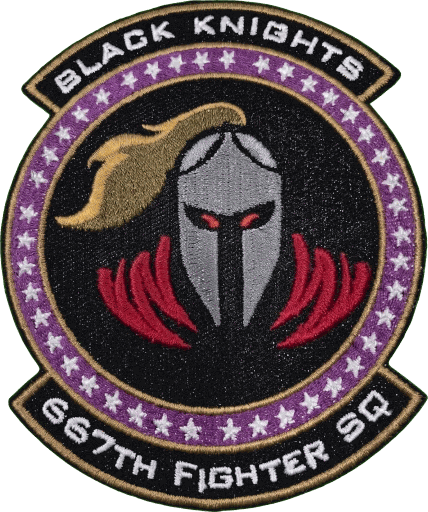

  
  

# Medusa IADS - Black Knight Edition (BKE)

Integrated Air Defense System for DCS World.

**[BKE]** **Medusa IADS - Black Knight Edition (BKE) v0.1.0**, based on Medusa v1.6.0.

Black Knight Edition is a customized version of Medusa, made to meet the particular preferences and needs of the 667th
Black Knights and the 51st VFW. Medusa is the work of Zach Shepard, and we thank him for it: BKE exists because
Medusa is so good to build on. His Medusa, at [github.com/medusa-iads/medusa](https://github.com/medusa-iads/medusa)
and [medusa.airdefense.systems](https://medusa.airdefense.systems), is the official version. He, and anyone else, is
welcome to take any of our changes or ideas, in whole or in part, in the spirit of open source.

BKE is set up the same way as Medusa, and Medusa missions load in it as they are (one naming change for lone Dog Ears,
below). BKE changes and additions are tagged **[BKE]** throughout this repository's docs; replaced stock wording in
stock files is kept in ~~strikeout~~.

## [BKE] Black Knight Edition Medusa Changes

Medusa's idea is an IADS that only knows what its sensors could know, and acts on it the way real crews would. BKE
pushes further in that direction: the network decides *what* a contact is from evidence it could plausibly have (how
it flies, how big its return is, what a crew saw), never from what DCS knows the object to be. The decoy,
re-acquisition, ground-sensor and crew behaviors each have a doctrine switch; the HARM corrections, contact evidence
and fixes are always on. Every switch is on by default except training mode. The full list is in
[Differences from Medusa 1.6.0](docs/differences-from-medusa-1.6.0.md).

**Existing missions:** an unnamed Dog Ear in a group without missile launchers is no longer an always-on
early-warning radar (see Local cueing radars below). Name it with the `ewr` token, or set doctrine
`LocalCueingRadars = false`, to keep it always on. A cueing Dog Ear is not an early-warning radar, so stock
Medusa's fallback of using SAM radars as early-warning radars when none is left (`SAMAsEWR = "WHEN_NO_EWR"`) starts
for a network whose only radar is a lone, unnamed Dog Ear.

### Faster, fairer HARM defense

- **HARMs are recognized in time to matter.** Stock 1.6.0 needed 25 radar looks and a 10 s wait before it would call
  a contact an ARM, about two minutes, often after impact. BKE needs 5 looks: a HARM on a HOT S-300 or Tor is called
  in about 10 s, one seen only by early-warning radars in about 50 s. Shutdowns and point defense now happen while
  the missile is still in the air. ([medusa#41](https://github.com/medusa-iads/medusa/issues/41))
- **Radars refresh at their own pace.** Early-warning radars update their tracks every 10 s, SAM search radars every
  5 s, a HOT engagement radar every 2 s. A track held by a fire-control radar is sharper than one held by a long-range
  search set, as it should be. Tunable per kind with doctrine `ScanUpdateRateSec`.
- **An ARM stays an ARM.** A confirmed Kh-58 or ALARM slowing in its terminal dive is no longer relabeled an aircraft
  a few seconds before it kills the radar. The label clears only when the flight stops looking like an attack on a
  SAM site.
- **The shooter gets found.** The aircraft that fired a confirmed HARM is identified from its track history whatever
  the radar refresh rate (stock missed about half the launchers seen only by early-warning radars).
- **No banked "it's a jet" evidence.** An aircraft tracked for minutes can no longer build up so much aircraft
  evidence that a real ARM-like run is never recognized.
- **A bomb is not a missile.** A contact first seen just below an aircraft, where a store dropped in the last few
  seconds would be, that never speeds up on its own has no motor, so it is not confirmed as an ARM, however it dives
  at a radar (alert zones still see it, and point defense still engages it if it is falling on the site it protects).
  Its height plus speed is compared with the aircraft's: every ARM in DCS gains far more within seconds of launch; a
  bomb or glide bomb never gains any, and a later gain still lifts the hold. Physics, not a weapon list. It needs the
  network to know the aircraft is one (an aircraft-sized return or a crew sighting) and to see the store within about
  10 s of its release. In test scenarios (replays of recorded DCS runs) at 2, 5 and 10 s looks it stopped all but 12,
  2 and 2 of the 136, 86 and 22 false ARM calls on FAB-250s and GBU-31s (those left were first seen 13-40 s after
  release), and no ARM was missed or called later. These figures come from replays of recorded DCS test flights. The
  debrief log says when this held a call back.

### Seeing what's out there: contact evidence

- **Size of the return.** Each radar look gives a noisy estimate of how big the contact looks (aspect, a fixed
  per-airframe offset, scan-to-scan flicker, more error at long range and on early-warning sets). A small, fast,
  ARM-like contact is called sooner; one the radars confidently see as aircraft-sized is never confirmed as an ARM,
  however hard it dives at a radar.
- **Launch cues.** A new contact that pops off an existing track and accelerates away is something that was just
  fired. This holds for every ARM in DCS we tested (AGM-88, AGM-45, AGM-122, ALARM, Kh-25MP, Kh-31P, Kh-58), not one
  missile's profile.
- **Crews name what they see close up.** Within 10 km by day (less at night or in bad weather) a crew that DCS says
  has identified a contact reports it as an aircraft, helicopter or weapon. No extra DCS knowledge is used.
- **Stealth is supposed to be hard.** Return size alone never turns an aircraft into a missile, and never confirms an
  ARM. When low-observable jets arrive in DCS they will be harder to classify, exactly as they should be.

### Decoys: TALDs stop soaking up the missiles

Stock Medusa engages a TALD like a fighter, and the decoys do their job: SAMs empty their rails into them. BKE gives
the network a way to see through them over time, using only what a radar operator could see.

- **Decoy assessment.** A large contact flying a long straight glide, losing energy faster than any powered aircraft
  descending, becomes a suspected decoy after 60 s and a probable decoy after about 90 s. Long- and medium-range SAMs
  stop engaging and waking for probable decoys; point defense still kills one whose glide is predicted to end at the
  site it protects. Climbing, accelerating, turning hard or simply outliving the glide clears the label for good, so a
  jet can't fake it. In test scenarios (replays of recorded DCS flights), 85% of TALDs were recognized and no jet,
  JSOW, SLAM-ER or ARM was.
- **Engage-air-weapons.** While a HOT battery sees only probable decoys and known aircraft, its crew is told not to
  fire at "weapons" on its own; the option goes back on as soon as anything else shows up. Its own missile in flight
  at a known aircraft no longer turns it back on (in DCS the option only stops missiles guiding on weapons). Unlike
  stock Medusa, BKE does not turn the option on every time a battery goes HOT: the mission's own setting stands until
  BKE's decoy responses change it.
- **Fire discipline.** When HARMs or other unknowns are in reach the option has to stay on, and DCS's crews then pick
  the decoys too. So a battery whose own fire-control radar locks a probable decoy, or that fires at one, turns the
  option off for 20 s: in DCS an SA-11 drops the lock and fires no missile at a decoy, and aircraft are still engaged.
  An SA-10's tracking radar does not show what the site fires at next, so there the hold mostly starts at its first
  shot at a decoy and some decoy shots remain. A battery holds at most three times per decoy (also after the decoy is
  re-acquired), then engages it; at most 80 s of holds in any 2 minutes. Anti-radiation missiles do not stop a hold:
  the HARM shutdown response and point defense deal with them. A decoy whose glide is predicted to end within 3 km of
  the battery is never held against: the battery defends itself, as against a glide weapon.
- **Test shots.** A HOT battery facing a lone suspected-decoy group fires one missile and watches what the group does,
  instead of ripple-firing a salvo. A decoy can't jink; an aircraft that turns, climbs or accelerates gives itself
  away. A battery whose missile is lost when its fire is held (in DCS, the SA-11) learns that on its first test shot
  and fires normally from then on.
- Doctrine switches: `DecoyAssessment`, `ManageEngageAirWeapons`, `DecoyTestShots`, `DecoyFireDiscipline`.

### Tracks that come back

- **Re-acquisition from evidence.** When a lost track reappears where it should be by now, flying as it should, the
  network picks it back up with its old id and what it already knew about it (identification, decoy label), whatever
  DCS object it is. A contact that shows up somewhere else is a new track; a missile coming off a jet never inherits
  the jet's track. A confirmed ARM that misses two of its radar looks in a row can be continued by a new contact, and
  its label carries over across gaps of 20 s or less (so not for an ARM held only by 10 s early-warning
  radars). Doctrine `EvidenceReacquisition`.

### Eyes and ears on the ground

- **Local cueing radars.** A short-range search radar in a group without missiles (a Dog Ear) is now a cueing radar
  instead of an always-on early-warning radar: dark until something comes near, then up long enough to cue its guns
  and MANPADs onto the nearest aircraft. The Shilka in a Dog Ear + Shilka group and the Iglas in a Dog Ear + Igla
  group are now actually directed by their radar. Name a Dog Ear with `ewr` to keep the old behavior. Doctrine
  `LocalCueingRadars`, `LocalRadarSweeps`.
- **Observer posts and crew reports.** Ground crews and observer posts (groups named with `obs` or `observer`) watch
  and listen for aircraft, limited by daylight, weather, terrain and distance, and radio in coarse, delayed, sometimes
  lost reports: "two fast movers, low, heading north". Reports wake MANPADs, cue guns, bring up cueing radars, and can
  wake a nearby short- or medium-range SAM to WARM. They never create a track or a firing solution. Doctrine
  `ObserverReports`, `LocalInitiative`.
- **Mission EMCON wins.** A mission that sets an EMCON policy for a role keeps that role's SAM batteries dark whatever
  the crews report, so ambush sites stay ambushes (cueing radars still come up for their guns; `MINIMIZE` stops their
  sweeps).

### Crews: skill, readiness and stress

An IADS is only as good as the people in it. BKE lets the crews' experience and state of mind shape what the network
learns, on top of (not instead of) what DCS's own unit skill does to how they shoot.

- **Set your crews' skill.** Whether a crew gets a usable report out at all, how fast and how accurate depends on its
  skill in the mission: an Average crew (the Mission Editor's default for ground units) manages a report about one
  time in four and takes minutes, an Excellent crew almost always and in about half a minute. Units spawned during a
  mission, and units set to Random or Player skill, count as Average (the doctrine's `CrewFactorsDefaultSkill`, which
  follows `CrewSuppression.DefaultCrewSkill` unless set). Give your observer posts and key crews Good skill or better.
- **Trained observers.** Observer posts (`obs` / `observer`) count one skill level higher, keep watching even when
  the network is surprised, and know whom to call.
- **Readiness.** Doctrine `Readiness` sets how ready the crews are at mission start: `SURPRISED` (peacetime routine,
  nobody expects anything), `ALERTED` (intel says an attack could come any time) or `ENGAGED` (a shooting war). Left
  out, it follows `Posture` (`HOT_WAR`, the default, is `ENGAGED`). Surprise wears off: a few minutes after the first
  hostile is tracked or reported the network is `ALERTED`, and its first launch (or, a minute or so later, its first
  loss) makes it `ENGAGED`. It never drops back on its own; a mission script can set it with
  `Medusa.API.setReadiness`. Readiness needs `CrewFactors` on, and changing `Posture` mid-mission does not change it.
- **Getting the word through.** A report must also reach someone who acts on it. A surprised network drops many
  reports (nobody is listening); a swamped one, with many raids, missiles and losses at once, drops them too. The
  sweet spot is a network that knows something is coming but is not yet overwhelmed. A busy network is also slower
  to identify new tracks.
- **Training mode.** Doctrine `TrainingMode = true` takes the luck out of detection, identification and reporting:
  every delay is its typical value, every report is made and delivered, and size estimates carry no noise. A pilot
  practising against the network gets an honest measure of how good the run was, not a lucky one. DCS's own radar
  detection and missile hits stay as DCS decides.
- **Debrief log.** In the normal (INFO) log, one-line `DEBRIEF|t=...|clock=HH:MM:SS|...` entries record what the
  network knew and when: first detection of each contact and by which sensor, identification, every radio report (not
  made, lost, or delivered and what it set off), readiness changes, batteries waking and why, ARMs confirmed or held
  back, decoys recognized, fire holds, and sites lost. `t` is seconds since
  mission start and `clock` the mission time of day, so the log lines up with Tacview.
- Doctrine switch: `CrewFactors` (skill, readiness and stress; default on).

### Alert zones for mission makers

- **React to what the IADS sees, with editor triggers only.** Give a trigger zone a `MedusaFlag` property and Medusa
  writes how many hostiles its radars track inside it. Filter by `MedusaThreats` (aircraft, ARMs, munitions),
  `MedusaAlt` and `MedusaSide`, hold contacts with `MedusaLinger`, count site losses with `MedusaLosses`. Scramble the
  alert flight when the radars see the raid, not when the editor knows it is there. See
  [docs/alert-zones.md](docs/alert-zones.md).

### Stock fixes

- SHORAD and SAM batteries spawned after start now get point-defense assignments.
  ([medusa#9](https://github.com/medusa-iads/medusa/issues/9))
- Radar-directed AAA recovering from crew suppression is re-linked to its battery.
- Event handlers no longer ask DCS for unit data of trees and missiles, and no longer log an error for each crew
  killed in one blast (removes floods of ERROR lines in dcs.log).
- Lighter server load: alert zones, HARM checks and observer looks are spread over frames. In benchmarks, 20 alert
  zones cost under 0.5 ms per tick, and HARM checks run about 5x faster with 300 tracks.

See [CHANGELOG.md](CHANGELOG.md) for the full list and the [docs](docs/README.md) for every feature and option.
Example configurations are in [examples](examples/).

## Quick Start

1. Load ~~`medusa.lua`~~ `medusa-bke.lua` via a DO SCRIPT FILE trigger
2. Name your SAM groups with the `iads.` prefix
3. That's it. Medusa handles the rest.

To change your prefix or customize the IADS behavior, keep reading on!

**[BKE]** Optional extras: name a lookout group `iads.<area>.obs.<label>` for an observer post, and set the skill of
your ground crews and observer posts above Average. See [Quick start](docs/quick-start.md).

## Documentation

Full documentation at [medusa.airdefense.systems](https://medusa.airdefense.systems)

**[BKE]** The website documents stock Medusa. Black Knight Edition is documented in [docs](docs/README.md), with the
same sections: [Installation](docs/installation.md), [Quick start](docs/quick-start.md),
[Configuration](docs/configuration.md), [Doctrine fields](docs/doctrine-fields.md), a page for each BKE feature,
[Differences from Medusa 1.6.0](docs/differences-from-medusa-1.6.0.md) and a [FAQ](docs/faq.md).

- [Installation](https://medusa.airdefense.systems/getting-started/installation/)
- [Configuration](https://medusa.airdefense.systems/reference/configuration/)
- [Doctrine](https://medusa.airdefense.systems/guides/doctrine/)
- [FAQ](https://medusa.airdefense.systems/getting-started/faq/)

## Downloads

- **[BKE]** Black Knight Edition: [GitHub Releases](https://github.com/51st-Vfw/medusa/releases) of this fork
  (`medusa-bke.lua`, `medusa-bke-thin.lua`, `medusa-bke.zip`, `medusa-bke-thin.zip`)
- [Latest release](https://github.com/medusa-iads/medusa/releases/latest) **[BKE]** of official Medusa (stock, not
  this edition)

## Contributing

**[BKE]** Please contribute to official Medusa, at
[github.com/medusa-iads/medusa](https://github.com/medusa-iads/medusa), rather than to this edition. Members of the 51st
VFW and the 667th with BKE requests or contributions: contact Blackdog of the 667th.

See [CONTRIBUTING.md](CONTRIBUTING.md) for the development workflow.

## License

[GPL-3.0](LICENSE), the license Medusa ships in its LICENSE file.

**[BKE]** Medusa IADS is the work of Zach Shepard (YoloWingPixie). Black Knight Edition is distributed under the same
license.
