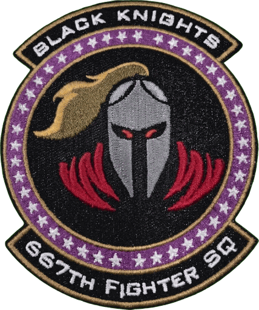

  
  

# Medusa IADS - Black Knight Edition (BKE) documentation

This is the documentation for **Medusa IADS - Black Knight Edition (BKE) v0.1.0**, based on Medusa v1.6.0.

BKE is Medusa with additions and changes for the 667th Black Knights and the 51st VFW. Everything Medusa 1.6.0 does,
BKE does too, set up the same way. These pages cover what BKE adds or changes, and every configuration and doctrine
option either version has. For a topic BKE does not change, the page links to the official Medusa documentation at
[medusa.airdefense.systems](https://medusa.airdefense.systems), which documents the official (stock) Medusa.

BKE content is marked **[BKE]**. Where a BKE page repeats a stock table, a stock default BKE changed is shown as
~~old~~ new.

## Getting started

| Page | What it covers | Official Medusa page |
|---|---|---|
| [Installation](installation.md) | Download `medusa-bke.lua`, load it in a mission, check that it runs | [Installation](https://medusa.airdefense.systems/getting-started/installation/) |
| [Quick start](quick-start.md) | A minimal mission, naming, a first doctrine, quick checks | [Quick Start](https://medusa.airdefense.systems/getting-started/quick-start/) |
| [Differences from Medusa 1.6.0](differences-from-medusa-1.6.0.md) | Every BKE change in one table, and the one change that can affect an existing mission | [Introduction](https://medusa.airdefense.systems/getting-started/introduction/) |
| [FAQ](faq.md) | BKE questions from mission makers and pilots | [FAQ](https://medusa.airdefense.systems/getting-started/faq/) |

## Guides

Stock guides that BKE leaves as they are: [Doctrine](https://medusa.airdefense.systems/guides/doctrine/),
[Multi-Network Setup](https://medusa.airdefense.systems/guides/multi-network/),
[MANPAD Groups](https://medusa.airdefense.systems/guides/manpad-groups/),
[AAA Groups](https://medusa.airdefense.systems/guides/aaa-groups/),
[Border Zones and Posture](https://medusa.airdefense.systems/guides/border-zones/) and
[Target Assignment](https://medusa.airdefense.systems/guides/target-assignment/). BKE adds to some of them; the pages
below say where.

| Page | What it covers |
|---|---|
| [Naming conventions](naming-conventions.md) | Stock naming, plus the BKE role tokens `obs` / `observer` (observer posts) |
| [HARM detection and contact evidence](harm-detection.md) | **[BKE]** Faster HARM classification, per-radar refresh rates, return size, launch cues, crew sightings, sticky ARM labels, finding the shooter |
| [Released stores: a bomb is not a missile](released-stores.md) | **[BKE]** Why a bomb or glide bomb dropped near a radar is not called an ARM |
| [Decoys and fire discipline](decoys.md) | **[BKE]** Recognizing TALD-type decoys, engage-air-weapons, fire holds, test shots |
| [Track re-acquisition](track-reacquisition.md) | **[BKE]** Picking a lost track back up from where it should be and how it flies |
| [Local cueing radars and observer posts](local-radars-and-observers.md) | **[BKE]** Dog Ear-type radars that cue guns and MANPADs, crews and observer posts that radio what they see |
| [Crews, readiness and training mode](crews-and-readiness.md) | **[BKE]** Crew skill, readiness (`SURPRISED` / `ALERTED` / `ENGAGED`), net load, training mode |
| [Alert zones](alert-zones.md) | **[BKE]** Trigger zones whose flags count what the IADS radars see, for editor triggers |
| [Debrief log](debrief-log.md) | **[BKE]** The `DEBRIEF` lines in dcs.log: every event and its fields |

## Reference

| Page | What it covers | Official Medusa page |
|---|---|---|
| [Configuration](configuration.md) | Every `MEDUSA_CONFIG` field | [Configuration](https://medusa.airdefense.systems/reference/configuration/) |
| [Doctrine fields](doctrine-fields.md) | Every doctrine field, stock and BKE: type, default, range, effect | [Doctrine Fields](https://medusa.airdefense.systems/reference/doctrine-fields/) |
| [Runtime API](api.md) | `Medusa.API`, with the BKE `getReadiness` / `setReadiness` | [Runtime API](https://medusa.airdefense.systems/reference/api/) |
| [Changelog](../CHANGELOG.md) | BKE releases, then Medusa's own history | [Changelog](https://medusa.airdefense.systems/changelog/) |

The official [Config Builder](https://medusa.airdefense.systems/reference/config-builder/) writes stock fields only;
add BKE fields by hand (see [examples](../examples/)).

## Monitoring

BKE leaves metrics and the tactical display as they are:
[Prometheus and Grafana](https://medusa.airdefense.systems/monitoring/prometheus-and-grafana/) and
[Tactical Display](https://medusa.airdefense.systems/monitoring/tactical-display/). For after-action review, BKE adds
the [debrief log](debrief-log.md).

## Examples

| File | What it shows |
|---|---|
| [bke-doctrine-config.lua](../examples/bke-doctrine-config.lua) | Every BKE doctrine field at its default, commented |
| [bke-stock-behaviour-config.lua](../examples/bke-stock-behaviour-config.lua) | Every BKE switch off, to compare with Medusa 1.6.0 |
| [bke-ground-sensors-config.lua](../examples/bke-ground-sensors-config.lua) | Group naming for observer posts and local cueing radars, with their settings |
| [bke-alert-zones.lua](../examples/bke-alert-zones.lua) | Alert-zone trigger-zone properties and the editor triggers that read them |
| [bke-training-config.lua](../examples/bke-training-config.lua) | Training mode for practice against the network |
| [bke-surprised-network-config.lua](../examples/bke-surprised-network-config.lua) | A network that starts surprised, raised by a mission script |
| [manpads-test-config.lua](../examples/manpads-test-config.lua) | Stock MANPAD settings with debug logging and metrics |

## Diagrams

Medusa's own design diagrams (stock, unchanged), with their D2 sources in [diagrams](diagrams/):

- [Asset classification and routing](diagrams/asset-classification-and-routing.svg)
- [Assignment pipeline](diagrams/assignment-pipeline.svg)
- [Local defense modules](diagrams/local-defense-modules.svg)
- [AAA state machine](diagrams/aaa-state-machine.svg)
- [MANPAD state machine](diagrams/manpad-state-machine.svg)

They show Medusa 1.6.0. BKE adds steps the diagrams do not show: local cueing radars sit with the local defense
modules, and the decoy and released-store checks sit between track classification and assignment.
